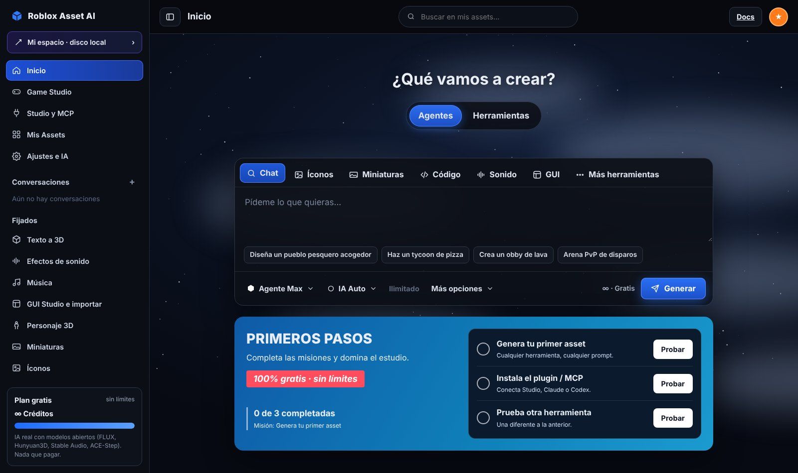
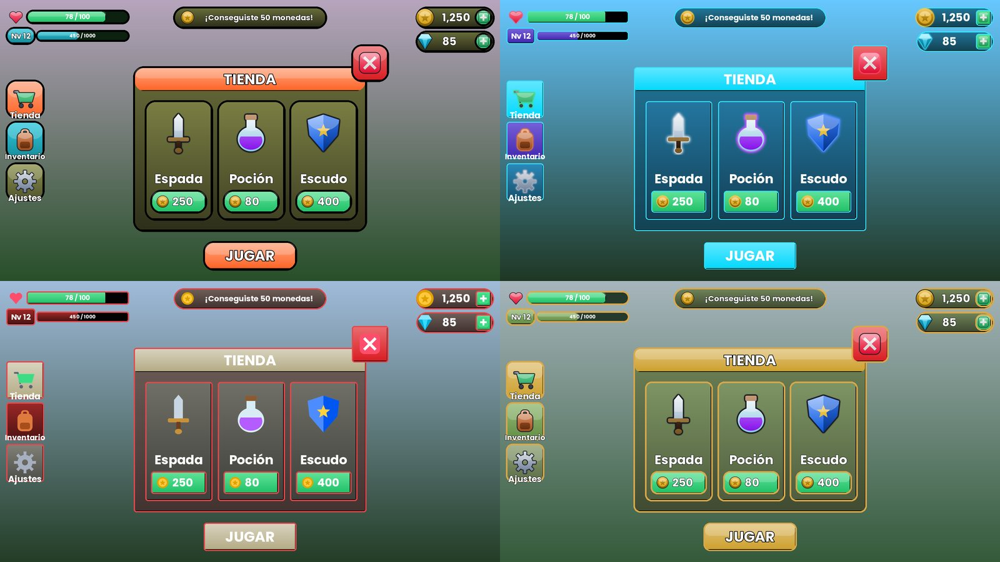
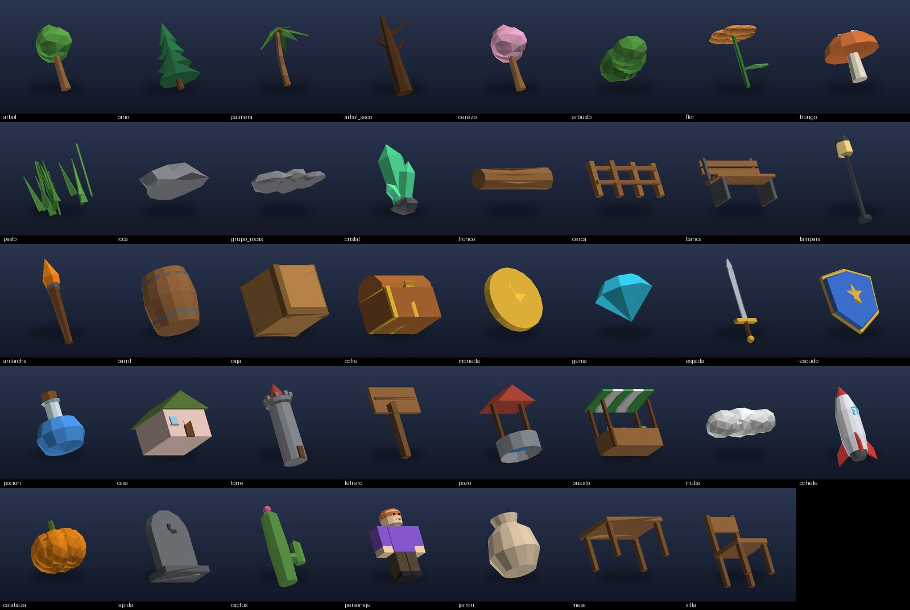

# Roblox Asset AI

**Estudio de assets para juegos de Roblox con IA generativa, gratuito y portable.**
Escribes lo que quieres ("un tycoon de pizza", "espada de fuego", "rugido de dragón") y genera
íconos, interfaces (GUI) reales, miniaturas, modelos 3D con textura, efectos de sonido, música,
scripts Luau y la estética completa del mapa, listos para Roblox Studio.



- **IA real con modelos abiertos y gratuitos:** FLUX.1-schnell (imágenes), Hunyuan3D-2 (3D con textura),
  Stable Audio Open (efectos), ACE-Step / MusicGen (música) y un LLM (Ollama, Pollinations o Claude) para el agente y el código.
- **Funciona sin internet:** si ninguna IA responde, cada herramienta usa su generador procedural.
- **Portable:** todo (Python, paquetes, modelos, Blender, resultados) vive en la carpeta del proyecto. Ideal para un disco externo.
- **Blender opcional:** limpia y reduce los modelos de la IA conservando la textura, pule los procedurales y exporta GLB + FBX.
- **Integración con Roblox:** plugin de Studio, scripts para la Command Bar, subida con Open Cloud y servidor MCP para agentes.

---

## Requisitos

- Windows 10 (1803 o superior) u 11, de 64 bits.
- ~200 MB libres (+ ~1,2 GB si instalas Blender).
- Internet para instalar y para usar la IA gratuita (el modo procedural funciona sin internet).
- Opcional: GPU NVIDIA para correr los modelos en tu PC (`INSTALAR_IA_LOCAL.bat`).

## Instalación

1. **Descarga el proyecto:** botón verde **Code → Download ZIP** y descomprímelo donde quieras
   (por ejemplo, un disco externo). O con git:
   ```
   git clone https://github.com/ElGrossoplay/roblox-asset-ai.git
   ```
2. **Instala la base:** doble clic en **`INSTALAR.bat`**. Descarga Python portable y las librerías dentro de la carpeta
   (no instala nada en Windows). Si aparece *"Windows protegió su PC"*: **Más información → Ejecutar de todas formas**.
3. **Verifica:** doble clic en **`DIAGNOSTICO.bat`**. Los paquetes deben salir en verde; Blender y Ollama son opcionales.
4. **Abre la app:** doble clic en **`INICIAR.bat`**. Se abre una ventana negra (el servidor; no la cierres) y el navegador en
   `http://127.0.0.1:8765`. Para apagar la app, cierra esa ventana.

## Primeras pruebas

1. **Sin IA (comprobar la instalación):** en el selector de motor elige **Procedural** y pide en la pestaña Chat
   *"Haz un tycoon de pizza"*. En segundos aparecen GUI, miniatura, sonidos, música y modelos.
2. **Activa la IA gratis:** crea un token gratuito (tipo *Read*) en <https://huggingface.co/settings/tokens>.
   En la app ve a **Ajustes e IA**, pégalo, **Guardar** y **Probar conexiones IA**.
3. **Con IA:** cambia el motor a **IA Auto** y prueba:
   - Íconos: *"espada de fuego, arco de hielo y poción"*
   - Sonido: *"rugido de dragón lejano"*
   - Más herramientas → Texto a 3D: *"cofre del tesoro dorado"* (puede tardar 1 a 3 minutos)

   Cada resultado muestra la etiqueta **IA** o **procedural** según quién lo generó.

## Herramientas

| Herramienta | Qué genera |
|---|---|
| **Chat (Agente)** | Entiende el pedido y usa una o varias herramientas; con una idea de juego arma mundo, GUI, íconos, 3D, sonidos, música, miniatura y código |
| **Íconos** | Íconos de cualquier objeto en sets de estilo consistente (cartoon, plano, neón, pixel, realista, anime…) con fondo transparente |
| **GUI** | `ScreenGui` real y editable (HUD, monedas, barras, tienda, inventario, botones) con arte IA en 9 partes |
| **Miniaturas** | Miniatura 1920×1080 + ícono de juego 512×512 con título |
| **Texto a 3D** | Modelos `.glb` con textura (objetos, mascotas, vehículos, personajes) o **imagen → 3D** |
| **Sonido / Música** | Efectos de cualquier descripción y música por género (lofi, chiptune, synthwave, orquestal, reggaetón…) |
| **Código** | Scripts Luau a medida o desde una biblioteca (monedas + DataStore, tienda segura, rondas, checkpoints…) |
| **Game Studio** | Estética del mapa: iluminación, atmósfera, cielo 360°, texturas PBR, ambiente y props |





## Blender (opcional)

Ejecuta **`INSTALAR_BLENDER.bat`**: descarga Blender LTS oficial y portable (verificado con SHA-256) a `runtime\blender`.
Si ya tienes Blender 3.6 o superior instalado, se detecta solo. Con Blender los modelos se reducen bajo el límite de
20.000 triángulos de Roblox **sin perder la textura**, se exportan en GLB + FBX y se renderizan vistas previas.

## Usar los assets en Roblox Studio

- **GUI y estética:** botón **Copiar script** → pégalo en la Command Bar de Studio (*View → Command Bar*).
- **Modelos:** *File → Import 3D* con el `.glb` o `.fbx` (si el tamaño no coincide, usa *Scale Unit: Stud*).
- **Plugin:** en Studio, *Plugins → Plugins Folder*, copia `studio-plugin\RobloxAssetAI.plugin.lua` y reinicia.
  Con la app abierta, importa GUIs, scripts y estéticas con un clic.
- **Subida automática (opcional):** crea una API key en <https://create.roblox.com/dashboard/credentials>
  (permiso *Assets: read + write*), pégala en **Ajustes e IA** junto a tu ID de usuario y usa **Subir a Roblox**.

## MCP (agentes como Claude)

Agrega el contenido de [`MCP_CONFIG_EJEMPLO.json`](MCP_CONFIG_EJEMPLO.json) a la configuración MCP de tu cliente
(ajusta la ruta a tu carpeta). Herramientas: `generar_juego`, `generar_iconos`, `generar_gui`, `generar_miniatura`,
`generar_sonido`, `generar_musica`, `generar_codigo`, `generar_modelo3d`, `generar_mundo`, `listar_assets`.

## Configuración

| Archivo | Para qué |
|---|---|
| `config\config.toml` | Opciones generales, Blender, servidor, Roblox |
| `config\ia.toml` | Orden de los motores de IA y lista de Spaces de Hugging Face (si uno deja de existir, agrega otro) |
| `config\secrets.env` | Tus claves (se crea desde **Ajustes e IA**; nunca se sube a GitHub) |

## Solución de problemas

- Ejecuta **`DIAGNOSTICO.bat`** y revisa `logs\diagnostico.txt`.
- Registro de la app: `logs\app.log`. Registro de Blender: `logs\blender_ultimo.log`.
- Resultado marcado como *procedural* cuando querías IA: el motor no respondió (cuota gratuita agotada, Space caído o
  sin internet). Revisa **Probar conexiones IA** o intenta más tarde.
- Puerto ocupado: la app usa el siguiente libre automáticamente.

Manual completo: [LEEME.md](LEEME.md).

## Licencias de los modelos

Revisa la licencia de cada modelo antes de publicar un juego monetizado:
FLUX.1-schnell y ACE-Step (Apache 2.0, uso comercial libre) · Hunyuan3D-2 (Tencent Hunyuan Community License,
uso comercial con límites; no aplica en UE, Reino Unido ni Corea del Sur) · Stable Audio Open (Stability AI Community
License, gratis bajo 1 M USD de ingresos anuales) · MusicGen (CC-BY-NC, no comercial).
La fuente incluida (Poppins) usa la SIL Open Font License.

---

Proyecto independiente, sin relación con Roblox Corporation ni con otros servicios de generación de assets.
